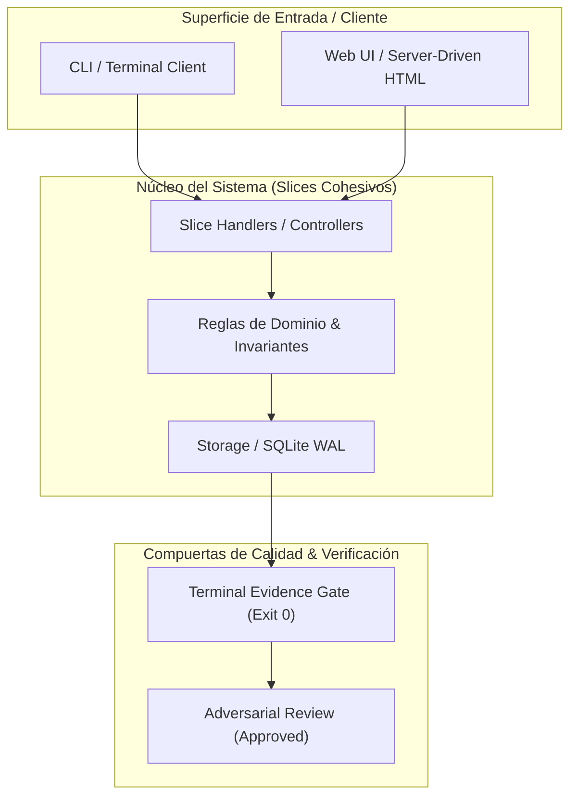

# EXECUTIVE_BRIEF.md
> Panorama General de Arquitectura, Grafo de Procesos y Matriz de Riesgos — Producido por Paso 2.5 (P02b)
> Path recomendado: `EXECUTIVE_BRIEF.md` o presentado en chat del orquestador antes de P03/P04.

Proyecto: [Nombre del Sistema]  
Tipo de Plan: [Plan A — Greenfield / Plan A-L — Greenfield Large]  
Fecha: [YYYY-MM-DD]  
Arquitecto Responsable: [Nombre / q-agent]  
Estado: [BORRADOR / PENDIENTE DE APROBACIÓN HUMANA]

---

## 1. VISIÓN GENERAL Y ALCANCE NUCLEAR (CORE VALUE LOOP)

### 🎯 Bucle de Valor Mínimo
- **Entrada del Usuario:** [Qué provee el usuario o sistema externo para iniciar el flujo]
- **Procesamiento Central:** [Transformación de dominio o invariante nuclear que ejecuta el sistema]
- **Salida de Valor:** [Resultado observable directo de negocio]

### 📌 Alcance Positivo (In Scope — MVP / Fase 1)
| # | Módulo / Slice | Descripción de Capacidad | Criterio de Done Observable |
|---|---|---|---|
| 1 | [Nombre Slice 1] | [Qué resuelve] | [Test / Salida observable exit code 0] |
| 2 | [Nombre Slice 2] | [Qué resuelve] | [Test / Salida observable exit code 0] |

### 🚫 Alcance Negativo Explícito (Out of Scope / Diferido a Fase 2+)
> ⚠️ Lo que explícitamente **NO** se construye en esta iteración para evitar sobreingeniería y context rot:
- **Exclusión 1:** [ej. Auth multi-tenant / RBAC distribuido — Diferido a Fase 2]
- **Exclusión 2:** [ej. Base de datos distribuida o broker de mensajería — Reemplazado por SQLite WAL local]
- **Exclusión 3:** [ej. UI compleja con framework SPA pesado — Reemplazado por CLI / Server-Driven HTML]

---

## 2. HOJA DE RUTA POR OLAS (WAVE-BASED EXECUTION PLAN)

```text
Wave 1 (Fundaciones) ──► Wave 2 (Core Slices) ──► Wave 3 (UI & Handlers) ──► Wave 4 (Hardening)
```

| Ola | Enfoque Principal | Slices / Componentes Clave | Verificación Esperada |
|---|---|---|---|
| **Wave 1** | **Fundaciones & Persistencia** | Esquema DB (SQLite WAL), modelos puros, repositorios | Tests unitarios de persistencia y migraciones |
| **Wave 2** | **Core Loop & Slices Verticales** | Casos de uso de negocio, invariantes de dominio | Tests de integración de dominio, TDD RED-to-GREEN |
| **Wave 3** | **Exposición, UI & Handlers** | Handlers HTTP/CLI, plantillas higiénicas, endpoints | Smoke tests de endpoints, exit code 0 en CLI |
| **Wave 4** | **Higiene, Hardening & Compliance** | Linters oficiales, CAB-RP audit, probes de spec | Zero warnings, 100% tests verdes, revisión adversarial |

---

## 3. GRAFO DE PROCESOS Y TOPOLOGÍA (MERMAID DAG)



---

## 4. MATRIZ DE RIESGOS Y MODOS DE FALLO (THE 3 AM TEST)

| ID | Riesgo / Vector de Falla | Probabilidad | Impacto | Invariante Protegido | Modo de Falla (¿Qué degrada vs qué crashea?) | Mitigación Arquitectónica |
|---|---|---|---|---|---|---|
| **R-01** | Bloqueo o contención de base de datos | Media | Alto | Integridad de transacciones | Degrada con busy timeout; jamás corrompe el archivo | SQLite WAL + `busy_timeout=5000` + pool 1 writer |
| **R-02** | Fuga de credenciales o API keys | Baja | Crítico | Seguridad de secretos | Crashea con error de configuración si falta secret | Cero tokens en repo / `q-secrets` o proxy loopback |
| **R-03** | Pérdida de estado ante reinicio abrupto | Media | Alto | Recuperación determinista | Degrada a estado 'uncertain'; reanuda por log | Bitácora viva en disco + SQLite attempt records |
| **R-04** | Inyección de datos no sanitizados | Media | Crítico | Sanitización de entrada | Rechaza con HTTP 400 / error de validación | Sentencias SQL parametrizadas + escape HTML contextual |

---

## 5. COMPUERTA DE APROBACIÓN HUMANA

> ⛔ **BLOQUEO**: Prohibido inicializar tareas en la bitácora viva (P04) ni modificar código fuente sin la aprobación explícita de este Executive Brief por parte del usuario.

- [ ] Visión y alcance positivo/negativo comprendidos y validados.
- [ ] Hoja de ruta en olas acordada.
- [ ] Grafo de procesos y dependencias validado.
- [ ] Matriz de riesgos y mitigaciones aprobada.

**Decisión del Usuario:** `[APROBADO PARA IMPLEMENTACIÓN / AJUSTAR ESPECIFICACIÓN]`
